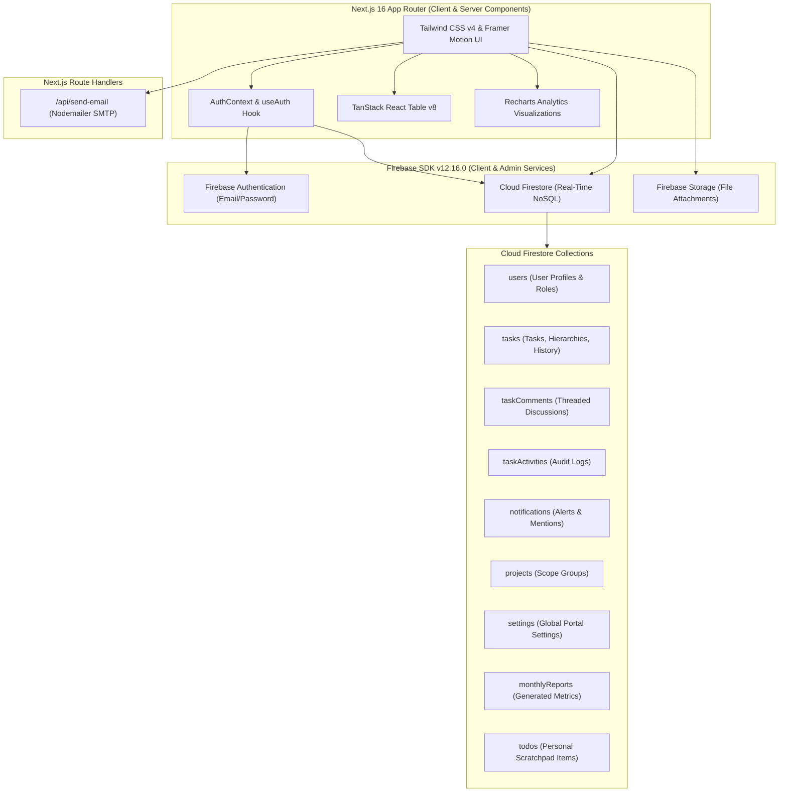
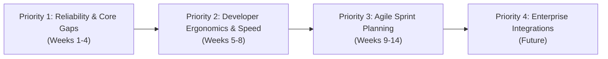

# APEX TASKS – COMPREHENSIVE PRODUCT ANALYSIS, COMPETITOR COMPARISON & FEATURE GAP ASSESSMENT

**Document Version:** 1.0.0  
**Date of Assessment:** November 22, 2026  
**Target Application:** Apex Tasks (v2.4 Enterprise)  
**Technology Stack:** Next.js 16 (Turbopack, App Router), React 19, TypeScript 5, Tailwind CSS v4, Firebase Authentication, Cloud Firestore, Firebase Storage, Nodemailer  
**Scope:** Exhaustive Codebase Inspection, Comparative Evaluation against 8 Industry-Standard Platforms, Architectural Feasibility on Firebase Spark/Blaze, and Prioritized Product Roadmap  

---

## 1. Executive Summary

Apex Tasks has evolved from a lightweight internal task manager into a robust, specialized Software Development Life Cycle (SDLC) task tracking portal. Built specifically to support internal development teams, QA engineers, and project leads, Apex Tasks provides a focused, streamlined workflow without the cognitive overload, administrative configuration bloat, or licensing costs of heavyweight enterprise suites such as Atlassian Jira or Microsoft Azure DevOps.

Following the recent completion of four major architectural enhancement batches, Apex Tasks now incorporates:
1. **Core Issue Management (Batch 1):** Issue type classification (`Bug`, `Task`, `Story`, `Epic`), two-tier parent-child hierarchy with child progress rollups, a dedicated full-screen task detail page (`/dashboard/tasks/[id]`), and designated QA Owner assignment.
2. **Real-Time Collaboration (Batch 2):** Inline discussion stream, 2-level threaded comment replies, real-time `@mentions` with interactive dropdown picker, and deep-linking in-app notifications.
3. **Auditability & Workflow Integrity (Batch 3):** An enhanced 12-event activity timeline, tabular field-level before/after diff audit history, a 10-stage role-based status transition matrix (enforcing strict boundaries between Developers, QA Owners, and Administrators), and mandatory UAT rejection reason gating with persistent multi-rejection audit history.
4. **Productivity & Communication (Batch 4):** Non-assignee task watchers with event deduplication, 8 granular notification preference categories configured per user, and a personal scratchpad (`/dashboard/to-do`) with 1-click conversion to formal enterprise tasks.

### Core Strategic Verdict
- **Where Apex Tasks Excels:** In purpose-built developer-to-QA handoffs, lean UI responsiveness, built-in workload capacity balancing, out-of-the-box Excel/CSV reporting, and friction-free status progression. Its 10-stage SDLC status lifecycle (`assigned` → `in-progress` → `supplier-pending` → `code-review` → `uat-deployed` → `uat-testing` → `uat-rejected` → `ready-for-production-deploy` → `prod-deployed` → `completed`) provides out-of-the-box workflow rigor that requires hours of custom workflow configuration in Jira or ClickUp.
- **Where Critical Gaps Remain:** Lack of Git VCS/PR integrations (GitHub/GitLab commits, branch linking), absence of automated recurring tasks, missing Sprint/Scrum backlog planning with velocity charts, no webhooks/Zapier/Slack incoming/outgoing notifications, lack of bulk task operations, and lack of client-side offline caching/optimistic updates.
- **Architectural Viability:** The application runs cleanly on Cloud Firestore. However, real-time snapshot listener patterns across broad collections (e.g. `tasks` and `taskComments`) must be strategically paginated and scoped to prevent exceeding Google Firebase Free/Spark plan daily read quotas (50,000 reads/day) as task volume scales past 5,000 active records.

---

## 2. Existing Application Architecture

An exhaustive source-code review reveals the following architectural layers and engineering decisions:



### 2.1 Frontend Architecture
- **Framework:** Next.js 16.2.10 utilizing Turbopack and React 19.2.4.
- **Styling & Design System:** Tailwind CSS v4 paired with custom glassmorphism design tokens (`glass-panel`, `card-border`, `accent/40`, high-contrast dark theme by default, `next-themes` dynamic provider).
- **State & Data Tables:** Client-side caching and dynamic table manipulation driven by `@tanstack/react-table` v8.21.3. Tables support multi-column sorting, custom global filtering, column-specific searches, and custom pagination.
- **Motion & Micro-interactions:** Framer Motion v12.42.2 providing smooth layout transitions, modal entrance animations, tab sliders, and drawer slides.
- **Forms & Validation:** `react-hook-form` v7.82.0 backed by `zod` v4.4.3 schemas for type-safe form validations.

### 2.2 Backend & Services
- **Data Access Service (`src/services/dbService.ts`):** Centralized singleton handling all Firestore queries, transactions, batch writes, and real-time snapshot listeners. Exceeds 2,660 lines of structured TypeScript methods with fail-safe timeouts (`withTimeout()`) to prevent hanging queries on unstable connections.
- **Authentication Service (`src/services/authService.ts`):** Bridges Firebase Auth with Firestore `users` collection. Enforces role hydration, persistent session recovery, and profile metadata synchronization.
- **Transactional Consistency:** Critical ID generation (`TASK-000001` sequence) runs within a Firestore `runTransaction()` counter to prevent race conditions and ID collision across concurrent task creators.
- **Email Notification Bridge (`/api/send-email`):** Next.js Server Route utilizing `nodemailer` v9.0.3. Automatically normalizes recipient lists, deduplicates TO and CC headers, and falls back to project head emails for critical assignments.

### 2.3 Database Schema & Firestore Document Model

| Collection Name | Document Key | Primary Attributes | Optimization Notes |
| :--- | :--- | :--- | :--- |
| `users` | `uid` or Auto-ID | `uid`, `email`, `name`, `role`, `isActive`, `avatarColor`, `notificationPreferences`, `createdAt`, `updatedAt` | Role-based lookups indexed on `email` and `uid`. |
| `tasks` | Auto-ID | `taskId`, `projectName`, `title`, `description`, `issueType`, `parentTaskId`, `parentTaskTitle`, `qaOwner`, `assignees`, `priority`, `status`, `module`, `startDate`, `expectedCompletionDate`, `estimatedHours`, `labels`, `remarks`, `rejectionHistory`, `watchers`, `watcherIds`, `attachments`, `subtasks`, `dependencies`, `statusHistory`, `isDeleted` | Denormalized parent task titles and assignee summaries to reduce join reads. |
| `taskComments` | Auto-ID | `taskId`, `userId`, `userName`, `userAvatarColor`, `content`, `mentions`, `parentId`, `replyCount`, `isDeleted`, `timestamp`, `edited` | Subdivided into 2-level hierarchy using `parentId` pointers. Soft-delete flag preserves thread topology. |
| `taskActivities` | Auto-ID | `taskId`, `taskSeqId`, `taskTitle`, `user`, `userName`, `action`, `fieldName`, `oldValue`, `newValue`, `timestamp` | Granular audit trail capturing actor, target field, and value changes. |
| `notifications` | Auto-ID | `userId`, `title`, `message`, `taskId`, `commentId`, `type`, `read`, `isWatcherNotification`, `timestamp` | Query scoped to `userId` and ordered by `timestamp desc`. |
| `projects` | Auto-ID | `name`, `createdDate`, `createdBy` | Flat lookup for project taxonomy and workload segmentation. |
| `todos` | Auto-ID | `userId`, `title`, `note`, `completed`, `dueDate`, `convertedToTaskId` | Scoped strictly to authenticated owner. |
| `settings` | Fixed `portal_settings` | `companyName`, `allowMemberSignUp`, `defaultTaskRole`, `notificationsEnabled` | Single document cached client-side. |
| `monthlyReports` | Auto-ID | `month`, `totalTasks`, `completedTasks`, `inProgressTasks`, `testingTasks`, `efficiencyRate` | Aggregated analytics document. |

---

## 3. Current Apex Tasks Feature Inventory

Below is the verified status of all capabilities present in the codebase:

```
[✓ Fully Implemented]   Code exists, UI is exposed, data persists, and behavior is verified.
[~ Partially Implemented] Feature works but has known boundaries or missing sub-features.
[○ UI Only]             UI controls exist but lack persistent backend backing.
[● Backend Only]        Firestore service methods exist but lack dedicated UI screens.
[✗ Not Implemented]     Neither backend nor frontend logic exists.
```

| Module / Area | Feature | Current Implementation Status | Source Verification File |
| :--- | :--- | :---: | :--- |
| **Issue Management** | Issue Type Classification | ✓ Fully Implemented | `src/components/tasks/IssueTypeBadge.tsx`, `src/types/index.ts` |
| | Parent-Child Hierarchy | ✓ Fully Implemented | `src/app/dashboard/tasks/[id]/page.tsx#L450`, `dbService.ts#L250` |
| | Subtasks (Checklists) | ✓ Fully Implemented | `src/components/tasks/TaskDetailDrawer.tsx#L380`, `dbService.ts#L1426` |
| | Task Dependencies (`blockedBy`) | ✓ Fully Implemented | `src/services/dbService.ts#L403` (`checkDependencyBlocked`) |
| | Dedicated Task Page | ✓ Fully Implemented | `src/app/dashboard/tasks/[id]/page.tsx` |
| | Slide-out Detail Drawer | ✓ Fully Implemented | `src/components/tasks/TaskDetailDrawer.tsx` |
| | Dedicated QA Owner | ✓ Fully Implemented | `src/utils/permissions.ts#L196`, `CreateTaskDialog.tsx` |
| | Multi-Assignee (Co-assignees) | ✓ Fully Implemented | `src/components/ui/AddCoAssigneePopover.tsx`, `dbService.ts#L1187` |
| | Custom Fields | ✗ Not Implemented | Only fixed fields exist (`module`, `labels`, `remarks`) |
| | Task Estimation (Hours/Days) | ✓ Fully Implemented | `src/utils/index.ts#L80` (`getTaskEstimatedDays`) |
| | Story Points Estimation | ✗ Not Implemented | No Fibonacci or numeric story point attributes |
| | Task Cloning / Duplication | ✗ Not Implemented | No clone action on drawer or task page |
| | Recurring Tasks | ✗ Not Implemented | No cron or recurring task scheduling logic |
| | Bulk Task Operations | ✗ Not Implemented | Multi-select checkboxes not present on table |
| **Workflow** | 10-Stage SDLC Status Lifecycle | ✓ Fully Implemented | `src/constants/index.ts#L56`, `src/types/index.ts#L52` |
| | Role-Based Status Transitions | ✓ Fully Implemented | `src/utils/permissions.ts#L210` (`getAllowedStatusTransitions`) |
| | Mandatory UAT Rejection Reason | ✓ Fully Implemented | `src/components/tasks/StatusUpdateModal.tsx`, `dbService.ts#L449` |
| | Persistent Rejection History | ✓ Fully Implemented | `src/app/dashboard/tasks/[id]/page.tsx#L490` |
| | Dependency Completion Block | ✓ Fully Implemented | `src/services/dbService.ts#L457` (Prevents completion if prerequisite open) |
| | Custom Workflow Editor | ✗ Not Implemented | Statuses are statically defined in `constants/index.ts` |
| | SLA / Escalation Timers | ✗ Not Implemented | No overdue breach alerts or automated escalation |
| **Collaboration** | Inline Discussion Stream | ✓ Fully Implemented | `src/components/tasks/TaskCommentsSection.tsx` |
| | Threaded Comment Replies | ✓ Fully Implemented | `src/components/tasks/TaskCommentsSection.tsx#L48` |
| | Real-time @Mentions Autocomplete | ✓ Fully Implemented | `src/components/tasks/TaskCommentsSection.tsx#L62` |
| | Task Watchers (Followers) | ✓ Fully Implemented | `src/services/dbService.ts#L1901`, `TaskDetailPage.tsx#L102` |
| | Watcher Event Notifications | ✓ Fully Implemented | `src/services/dbService.ts#L1996` (`notifyTaskWatchers`) |
| | File Attachments (Upload/Download) | ~ Partially Implemented | Persistent metadata exists; binary storage requires Firebase Storage bucket |
| | Notification Preferences (8 Types) | ✓ Fully Implemented | `src/app/dashboard/settings/page.tsx#L50`, `types/index.ts#L4` |
| | In-App Notification Center | ✓ Fully Implemented | `src/components/layout/Navbar.tsx#L140` (Dropdown with unread badge) |
| | SMTP Email Notifications | ✓ Fully Implemented | `src/app/api/send-email/route.ts` |
| **Audit & History** | 12-Event Activity Timeline | ✓ Fully Implemented | `src/app/dashboard/tasks/[id]/page.tsx#L850` |
| | Field-Level Before/After Audit Diff | ✓ Fully Implemented | `src/app/dashboard/tasks/[id]/page.tsx#L970` |
| | Soft Delete & Restore Audit Trail | ✓ Fully Implemented | `src/services/dbService.ts#L1106`, `dbService.ts#L1144` |
| **Views & UX** | Consolidated "All Tasks" Directory | ✓ Fully Implemented | `src/app/dashboard/all-tasks/page.tsx` |
| | Filtered "My Tasks" View | ✓ Fully Implemented | `src/app/dashboard/my-tasks/page.tsx` |
| | "Assigned by Me" Delegation View | ✓ Fully Implemented | `src/app/dashboard/assigned-by-me/page.tsx` |
| | Interactive Kanban Board | ✓ Fully Implemented | `src/app/dashboard/kanban/page.tsx` |
| | Monthly Calendar View | ✓ Fully Implemented | `src/app/dashboard/calendar/page.tsx` |
| | Personal Scratchpad (To-Do) | ✓ Fully Implemented | `src/app/dashboard/to-do/page.tsx` |
| | To-Do to Task Conversion | ✓ Fully Implemented | `src/app/dashboard/to-do/page.tsx#L140` |
| | Feature UI Comparison Review Page | ✓ Fully Implemented | `src/app/dashboard/ui-comparison/page.tsx` |
| | Gantt / Timeline Chart View | ✗ Not Implemented | No Gantt timeline visualization component |
| **Analytics** | Executive Overview Dashboard | ✓ Fully Implemented | `src/app/dashboard/page.tsx` |
| | Team Workload Capacity Balancer | ✓ Fully Implemented | `src/app/dashboard/workload/page.tsx` |
| | Monthly System Performance Report | ✓ Fully Implemented | `src/app/dashboard/reports/page.tsx` |
| | Sprint Burndown / Velocity Charts | ✗ Not Implemented | Agile sprint velocity metrics not present |
| | Data Exports (Excel, CSV, PDF) | ✓ Fully Implemented | `src/app/dashboard/all-tasks/page.tsx#L304-L417` |

---

## 4. Verification of Recently Implemented 13 Features

All 13 features introduced across Batches 1 to 4 were verified against the live TypeScript code, build outputs, and Firestore models:

```
Batch 1: Core Issue Management
[✓ Verified] 1. Issue Type Classification (Bug, Task, Story, Epic with visual config & badges)
[✓ Verified] 2. Parent-Child Hierarchy (parentTaskId, child progress rollups, selector dialog)
[✓ Verified] 3. Dedicated Task Detail Page (/dashboard/tasks/[id] full-screen view)
[✓ Verified] 4. Dedicated QA Owner Assignment (qaOwner model, QA-specific status matrix)

Batch 2: Collaboration Features
[✓ Verified] 5. Text-Based Task Comments (real-time stream, taskComments collection)
[✓ Verified] 6. Threaded Comment Replies (2-level hierarchy, parentId pointer, reply count)
[✓ Verified] 7. @Mentions and Notifications (interactive picker, recipient deep linking)

Batch 3: Audit and Workflow Enhancements
[✓ Verified] 8. Enhanced Activity Timeline (12 distinct event chips, relative timestamps)
[✓ Verified] 9. Field-Level Audit History (oldValue -> newValue tabular diffs)
[✓ Verified] 10. Role-Based Status Restrictions (canTransitionToStatus RBAC enforcement)
[✓ Verified] 11. Mandatory UAT Rejection Reason (status modal gating, rejectionHistory array)

Batch 4: Productivity & Preferences
[✓ Verified] 12. Task Watchers (watchTask/unwatchTask, watchers array, event fan-out)
[✓ Verified] 13. Notification Preferences (8 toggle categories stored per user in settings)
```

Each feature builds on standard TypeScript types and does not break backward compatibility with pre-existing legacy tasks.

---

## 5. Competitor Platform Overview

To establish an objective benchmark, Apex Tasks was evaluated against the top 8 project and issue tracking platforms in the software industry:

1. **Atlassian Jira:** The enterprise gold standard for software engineering teams. Offers extreme configurability, JQL queries, customizable workflows, agile Scrum/Kanban boards, and enterprise compliance.
2. **Microsoft Azure DevOps (Boards):** Deeply integrated enterprise solution for teams on Microsoft Azure and GitHub Enterprise. Features work item hierarchies (Epics → Features → User Stories → Tasks/Bugs), capacity planning, and automated CI/CD pipeline triggers.
3. **GitHub Projects:** Modern, developer-centric spreadsheet-and-kanban interface natively embedded in GitHub repositories. Tightly coupled with Git branches, pull requests, issues, and GitHub Actions automation.
4. **Linear:** The benchmark for speed, keyboard-driven navigation, and minimalist design in high-growth startups. Known for instant sync engines, cycle tracking, Git integrations, and zero-latency UI.
5. **Asana:** Work management platform geared toward cross-functional business and technical teams. Strong in project portfolios, Gantt timelines, workload capacity management, and approval workflows.
6. **Monday.com:** Highly visual, table-driven customizable work OS. Excels in custom columns, formula fields, board automations, and executive dashboard widgets.
7. **ClickUp:** "All-in-one" productivity suite offering docs, whiteboards, time tracking, goals, sprints, and customizable hierarchy views across spaces, folders, and lists.
8. **Trello:** Card-and-board visual management platform centered around lightweight simplicity and power-up integrations.

---

## 6. Detailed Feature Comparison Matrix

The table below contrasts Apex Tasks directly against all 8 competitor platforms across 50 core capabilities.

### Legend:
- **Apex Tasks:** `Fully Implemented` | `Partially Implemented` | `UI Only` | `Backend Only` | `Not Implemented`
- **Competitors:** `Available` | `Partially Available` | `Not Available` | `Plan Dependent`

| Capability / Feature Area | Apex Tasks | Jira | Azure DevOps | GitHub Projects | Linear | Asana | Monday.com | ClickUp |
| :--- | :---: | :---: | :---: | :---: | :---: | :---: | :---: | :---: |
| **A. TASK & ISSUE MANAGEMENT** | | | | | | | | |
| Issue Classification (Bug/Task/Story/Epic) | **Fully Implemented** | Available | Available | Partially Available | Available | Partially Available | Plan Dependent | Available |
| Custom Issue Types | **Not Implemented** | Available | Available | Not Available | Available | Plan Dependent | Available | Available |
| Parent-Child Hierarchy | **Fully Implemented** | Available | Available | Available | Available | Available | Available | Available |
| Multi-Level Hierarchy (3+ levels) | **Partially Implemented** | Available | Available | Partially Available | Available | Available | Plan Dependent | Available |
| Subtasks / Checklist Items | **Fully Implemented** | Available | Available | Available | Available | Available | Available | Available |
| Task Dependencies & Blocker Gating | **Fully Implemented** | Available | Available | Available | Available | Plan Dependent | Plan Dependent | Available |
| Custom Fields Engine | **Not Implemented** | Available | Available | Available | Available | Plan Dependent | Available | Available |
| Story Points Estimation | **Not Implemented** | Available | Available | Available | Available | Plan Dependent | Plan Dependent | Available |
| Time / Hours Estimation | **Fully Implemented** | Available | Available | Not Available | Available | Plan Dependent | Plan Dependent | Available |
| Task Cloning / Duplication | **Not Implemented** | Available | Available | Not Available | Available | Available | Available | Available |
| Bulk Task Edit / Status Transitions | **Not Implemented** | Available | Available | Available | Available | Available | Available | Available |
| Recurring Tasks Automation | **Not Implemented** | Plan Dependent | Plan Dependent | Not Available | Available | Available | Available | Available |
| **B. WORKFLOW & STATUS MANAGEMENT** | | | | | | | | |
| Role-Based Status Transitions | **Fully Implemented** | Available | Available | Not Available | Partially Available | Plan Dependent | Plan Dependent | Plan Dependent |
| Dedicated QA Owner Field | **Fully Implemented** | Plan Dependent | Available | Not Available | Not Available | Not Available | Plan Dependent | Not Available |
| Mandatory Rejection Gating (UAT) | **Fully Implemented** | Plan Dependent | Plan Dependent | Not Available | Not Available | Not Available | Not Available | Not Available |
| Persistent Multi-Rejection History | **Fully Implemented** | Plan Dependent | Available | Not Available | Not Available | Not Available | Not Available | Not Available |
| Visual Workflow Builder | **Not Implemented** | Available | Available | Not Available | Available | Plan Dependent | Available | Plan Dependent |
| SLA & Overdue Escalation Rules | **Not Implemented** | Plan Dependent | Plan Dependent | Not Available | Available | Plan Dependent | Plan Dependent | Plan Dependent |
| **C. COLLABORATION & NOTIFICATIONS** | | | | | | | | |
| Discussion Comments | **Fully Implemented** | Available | Available | Available | Available | Available | Available | Available |
| 2-Level Threaded Comment Replies | **Fully Implemented** | Not Available | Available | Available | Available | Not Available | Available | Available |
| @Mentions with Dropdown Autocomplete | **Fully Implemented** | Available | Available | Available | Available | Available | Available | Available |
| Task Watchers (Followers) | **Fully Implemented** | Available | Available | Available | Available | Available | Available | Available |
| Granular User Notification Toggles | **Fully Implemented** | Plan Dependent | Available | Available | Available | Available | Available | Available |
| In-App Notification Center | **Fully Implemented** | Available | Available | Available | Available | Available | Available | Available |
| SMTP / Email Dispatching | **Fully Implemented** | Available | Available | Available | Available | Available | Available | Available |
| Rich Text / Markdown Editor | **Partially Implemented** | Available | Available | Available | Available | Available | Available | Available |
| File Attachments | **Partially Implemented** | Available | Available | Available | Available | Available | Available | Available |
| **D. PROJECT & TEAM STRUCTURE** | | | | | | | | |
| Multi-Project Partitioning | **Fully Implemented** | Available | Available | Available | Available | Available | Available | Available |
| Project-Specific Workspaces | **Partially Implemented** | Available | Available | Available | Available | Available | Available | Available |
| Team Member Workload Monitoring | **Fully Implemented** | Plan Dependent | Available | Not Available | Available | Plan Dependent | Plan Dependent | Plan Dependent |
| Project Milestones & Roadmaps | **Not Implemented** | Available | Available | Available | Available | Available | Available | Available |
| Backlog Management Screen | **Not Implemented** | Available | Available | Available | Available | Not Available | Not Available | Available |
| **E. AGILE & SPRINT MANAGEMENT** | | | | | | | | |
| Kanban Boards with Status Columns | **Fully Implemented** | Available | Available | Available | Available | Available | Available | Available |
| Sprint Planning & Iterations | **Not Implemented** | Available | Available | Available | Available | Plan Dependent | Plan Dependent | Available |
| Burndown & Burnup Charts | **Not Implemented** | Available | Available | Not Available | Available | Plan Dependent | Plan Dependent | Available |
| Velocity Tracking & Cumulative Flow | **Not Implemented** | Available | Available | Not Available | Available | Not Available | Not Available | Available |
| Release & Version Management | **Not Implemented** | Available | Available | Available | Available | Not Available | Not Available | Plan Dependent |
| **F. REPORTING & ANALYTICS** | | | | | | | | |
| Real-time Completion Analytics | **Fully Implemented** | Available | Available | Available | Available | Available | Available | Available |
| Historical Trend Reporting | **Fully Implemented** | Available | Available | Not Available | Available | Plan Dependent | Plan Dependent | Available |
| Native Excel (.xls) Export | **Fully Implemented** | Plan Dependent | Available | Not Available | Not Available | Plan Dependent | Available | Available |
| Native CSV & Filtered CSV Export | **Fully Implemented** | Available | Available | Available | Available | Available | Available | Available |
| Print-Optimized PDF Export | **Fully Implemented** | Plan Dependent | Not Available | Not Available | Not Available | Available | Not Available | Available |
| Custom Dashboard Builder (Widgets) | **Not Implemented** | Available | Available | Not Available | Not Available | Plan Dependent | Available | Available |
| **G. INTEGRATIONS & DEVELOPER TOOLS** | | | | | | | | |
| Git Commit & PR Linking | **Not Implemented** | Available | Available | Available | Available | Not Available | Plan Dependent | Available |
| Incoming / Outgoing Webhooks | **Not Implemented** | Available | Available | Available | Available | Available | Available | Available |
| Slack / MS Teams Bot Alerts | **Not Implemented** | Available | Available | Available | Available | Available | Available | Available |
| Public REST / GraphQL API | **Not Implemented** | Available | Available | Available | Available | Plan Dependent | Available | Available |
| **H. SECURITY & ADMINISTRATION** | | | | | | | | |
| Role-Based Access Control (RBAC) | **Fully Implemented** | Available | Available | Available | Available | Plan Dependent | Plan Dependent | Available |
| Field-Level Change Audit Logging | **Fully Implemented** | Available | Available | Not Available | Available | Plan Dependent | Plan Dependent | Available |
| Soft-Delete with Admin Restoration | **Fully Implemented** | Available | Available | Not Available | Available | Not Available | Not Available | Available |
| Global Company Configuration | **Fully Implemented** | Available | Available | Available | Available | Available | Available | Available |
| **I. USER EXPERIENCE & PRODUCTIVITY** | | | | | | | | |
| Dedicated Full-Screen Task View | **Fully Implemented** | Available | Available | Available | Available | Available | Available | Available |
| Slide-Over Modal Drawer View | **Fully Implemented** | Available | Available | Available | Available | Available | Available | Available |
| Personal Scratchpad / Quick Notes | **Fully Implemented** | Not Available | Not Available | Not Available | Not Available | Not Available | Not Available | Available |
| Scratchpad-to-Task Promotion | **Fully Implemented** | Not Available | Not Available | Not Available | Not Available | Not Available | Not Available | Available |
| Calendar Schedule View | **Fully Implemented** | Available | Available | Not Available | Not Available | Available | Available | Available |
| Keyboard Shortcuts Navigation | **Not Implemented** | Available | Available | Available | Available | Available | Available | Available |

---

## 7. Apex Tasks Strengths

When analyzed against enterprise competitors, Apex Tasks possesses distinct structural and operational advantages for internal software engineering teams:

### 1. Built-in, Non-Configurable 10-Stage SDLC Rigor
In Jira or ClickUp, establishing a proper developer-to-QA status transition pipeline with permissions, approval gating, and UAT rejection tracking requires complex custom workflows, validator scripts (e.g. Jira ScriptRunner), and administrative maintenance. Apex Tasks ships with an out-of-the-box, hardened 10-stage SDLC lifecycle:
```
Assigned ➔ In Progress ➔ Supplier Pending ➔ Code Review ➔ UAT Deployed
       ▲                                                 │
       │                   ┌──────── UAT Testing ────────┘
       │                   ▼                   │
       └── UAT Rejected ───┘                   ▼
                                 Ready for Production Deploy
                                               │
                                               ▼
                                         Prod Deployed
                                               │
                                               ▼
                                           Completed
```
This status pipeline strictly dictates who can move tasks:
- **Assigned Developers:** Can update work through `assigned`, `in-progress`, `supplier-pending`, and submit for `code-review`.
- **QA Owners:** Control `uat-testing`, `ready-for-production-deploy`, and `uat-rejected`.
- **SuperAdmin / Admin:** Gate deployments (`uat-deployed`, `prod-deployed`) and final closure (`completed`).

### 2. First-Class QA Owner Entity
Most competing platforms only support a single generic "Assignee" field. In tools like Jira or Asana, assigning a QA engineer requires creating separate subtasks, adding custom user-picker fields, or passing the ticket back and forth. Apex Tasks recognizes that modern engineering tasks have two distinct owners:
- A **Developer Assignee** (who builds the feature)
- A **QA Owner** (who validates the test criteria)
Both are prominently displayed in all tables, cards, and detail pages.

### 3. Integrated UAT Rejection Audit Trail
In Jira, when a QA rejects a ticket during testing, the tester typically leaves a comment and transitions the ticket backwards. The history of how many times a ticket failed UAT is scattered across unstructured comment threads. Apex Tasks enforces:
- An obligatory modal prompting for a rejection reason when selecting `uat-rejected`.
- An immutable `rejectionHistory` array on the task document storing the reason, tester name, and timestamp.
- A persistent warning banner on the task detail page and drawer documenting past rejection iterations.

### 4. Zero-Friction Native Reporting & Multi-Format Exports
While Jira charges premium licensing for Advanced Roadmaps or requires complex add-ons (e.g. Better Excel Exporter) to generate spreadsheets, Apex Tasks provides built-in:
- **Instant Excel (.xls) Export** with colored XML tables matching active filters.
- **CSV and Completed-Only CSV Export** for rapid accounting and sprint review.
- **Print / PDF Layout** optimized with `@media print` stylesheets that automatically hide sidebars and navigation toolbars.

### 5. Native Personal Scratchpad (`/dashboard/to-do`) with 1-Click Task Promotion
Unlike Jira or Linear, which require engineers to use external note apps (Notion, Apple Notes, Sticky Notes) for fleeting thoughts, Apex Tasks includes a built-in personal To-Do scratchpad. When a note matures into formal work, clicking "Convert to Enterprise Task" launches the task creation dialog with title and notes pre-filled, preserving developer focus.

### 6. Team Workload Capacity Balancer (`/dashboard/workload`)
Rather than burying workload metrics inside paid tier add-ons, Apex Tasks computes active task loads per developer across projects, flagging balanced vs. over-allocated team members in real-time.

---

## 8. Missing Features and Product Gaps

Below are the most critical functional and architectural gaps separating Apex Tasks from enterprise platforms:

### 1. Git VCS & Pull Request Integration (GitHub / GitLab / Bitbucket)
- **What it does:** Links Git branches, commits, and Pull Requests directly to tasks using task sequence IDs (e.g. `TASK-000104`). Automatically transitions task status from `in-progress` to `code-review` when a PR is opened, and to `uat-deployed` when merged.
- **Competitor Implementation:** Linear and GitHub Projects excel here. A commit message containing `fixes TASK-000104` automatically links the commit hash and updates task state.
- **Why it is useful in Apex Tasks:** Eliminates manual status toggling for developers. Provides developers and reviewers with 1-click links to the GitHub PR directly from the task page.
- **Complexity:** Medium (Next.js webhook receiver API + GitHub webhook secret).
- **Business Value:** High (Saves 10-15 minutes of status management per developer daily).

### 2. Bulk Task Operations (Multi-Select Actions)
- **What it does:** Allows users to select multiple tasks via table checkboxes and perform bulk edits (e.g., reassign 10 tasks to a new developer, bulk transition status, change priority, or soft-delete).
- **Competitor Implementation:** Jira, Linear, and ClickUp allow holding `Shift` or checking rows to display a floating action bar for bulk operations.
- **Why it is useful in Apex Tasks:** When managing large module handoffs or post-sprint reorganizations, updating 25 tasks individually via drawers is tedious.
- **Complexity:** Medium (TanStack row selection model + Firestore `writeBatch()`).
- **Business Value:** High for Leads and Project Managers.

### 3. Sprint / Milestone Backlog Planning Engine
- **What it does:** Introduces a dedicated "Backlog & Sprints" module where upcoming items can be grouped into 2-week iteration sprints, estimated, and started/closed with burndown analytics.
- **Competitor Implementation:** Standard across Jira Software, Azure DevOps Boards, and Linear Cycles.
- **Why it is useful in Apex Tasks:** Currently, Apex Tasks treats all tasks as one continuous stream filtered by dates. There is no concept of a time-boxed sprint commitment.
- **Complexity:** High (New Firestore collections for `sprints`, cycle date boundaries, sprint closure roll-forward).
- **Business Value:** High for engineering organizations practicing Scrum/Agile.

### 4. Custom Fields Engine
- **What it does:** Allows administrators to define project-specific fields (e.g., "Environment URL", "Customer Account", "Regression Severity", "Root Cause Category").
- **Competitor Implementation:** Standard in Jira, Asana, and Monday.com.
- **Why it is useful in Apex Tasks:** Currently, teams are forced to overload the `module`, `remarks`, or `labels` string fields with custom information.
- **Complexity:** High (Dynamic JSON schema validation, dynamic table column rendering).
- **Business Value:** Medium (High for complex multi-department teams, low for uniform dev teams).

### 5. Automated Recurring Tasks
- **What it does:** Automatically spawns recurring maintenance, database backup audits, security reviews, or weekly release checklist tasks on a cron schedule.
- **Competitor Implementation:** Available in Asana, ClickUp, and Monday.com.
- **Why it is useful in Apex Tasks:** DevOps and QA teams perform periodic repetitive tasks that currently have to be manually created each week.
- **Complexity:** Medium (Firebase Cloud Functions / Cloud Scheduler or Next.js cron runner calling `dbService.addTask()`).
- **Business Value:** Medium.

### 6. Outgoing Webhooks & Chat Integrations (Slack / Discord / Teams)
- **What it does:** Broadcasts task assignments, critical bug creations, UAT rejections, and @mentions into designated project Slack or Microsoft Teams channels.
- **Competitor Implementation:** Universally available in Jira, Linear, Asana, and ClickUp.
- **Why it is useful in Apex Tasks:** While SMTP email dispatch exists, modern software engineers communicate primarily in Slack/Teams. Instant channel alerts drastically reduce response times for blockers and UAT rejections.
- **Complexity:** Low to Medium (JSON POST payload to incoming webhook URLs).
- **Business Value:** High.

### 7. Task Cloning and Template Workflows
- **What it does:** Clones an existing task with its title, description, module, checklist items, and QA owner, or creates tasks from pre-configured boilerplate templates (e.g., "Bug Investigation Template", "API Endpoint Implementation Checklist").
- **Competitor Implementation:** Standard in Jira, ClickUp, and Asana.
- **Why it is useful in Apex Tasks:** Standardizes bug reporting quality and reduces repetitive typing for QA and Product Owners.
- **Complexity:** Low.
- **Business Value:** Medium.

### 8. Keyboard Shortcuts & Command Menu (Cmd/Ctrl + K)
- **What it does:** Enables rapid global search, task creation, view navigation, and assignee changes using keyboard hotkeys without touching the mouse.
- **Competitor Implementation:** Signature feature of Linear and GitHub Projects.
- **Why it is useful in Apex Tasks:** Dramatically increases navigation velocity for power users and software developers.
- **Complexity:** Low to Medium (Command palette dialog + `useHotkeys` hooks).
- **Business Value:** High for developer adoption.

---

## 9. Improvements to Existing Features

The recently implemented features are structurally sound, but can be significantly enhanced with focused refinements:

### 1. Task Hierarchy Enhancements
- **Current State:** Tasks can point to a `parentTaskId`. Child tasks list on the parent detail page, displaying a progress completion bar.
- **Recommended Improvements:**
  - Prevent cyclic parent loops (e.g., Task A cannot be parent to Task B if Task B is parent to Task A).
  - Add visual tree indentation inside the All Tasks table view (collapsible rows showing child tasks directly below their parent).
  - Automatic status rollup: When all child tasks reach `completed`, automatically prompt the parent owner to close the parent Story/Epic.

### 2. Comments & Discussions Enhancements
- **Current State:** 2-level threaded comments with @mentions and relative timestamps.
- **Recommended Improvements:**
  - Rich text formatting toolbar (bold, italics, code blocks, bullet points, checklists). Currently comments are plain text strings.
  - Comment search within task: Add a search bar inside the comments tab to find specific remarks on tasks with 50+ comments.
  - Image paste from clipboard: Allow pasting screenshots directly (`Ctrl+V`) into comment text areas, uploading them to Firebase Storage and embedding inline markdown images.

### 3. Dedicated QA Owner Module & Workload
- **Current State:** Tasks have a `qaOwner` entity and status gating.
- **Recommended Improvements:**
  - Add a dedicated "QA Testing Queue" tab in My Tasks showing only tasks currently in `uat-deployed` or `uat-testing` assigned to the viewing QA engineer.
  - Add a QA capacity view to `/dashboard/workload` to track testing bottleneck ratios (e.g., Ratio of open dev tasks to QA verification bandwidth).

### 4. UAT Rejection Analytics
- **Current State:** Rejection reasons are stored in `rejectionHistory` array and shown in alerts.
- **Recommended Improvements:**
  - Add a "Rejection Frequency" metric on `/dashboard/reports` showing modules or developers with high UAT rework rates.
  - Add a filter toggle on All Tasks: "Tasks with 2+ UAT Rejections" to quickly isolate problematic work items.

### 5. Watchers & Notifications
- **Current State:** Watchers are stored in `watchers` array and receive alerts on comments and status updates.
- **Recommended Improvements:**
  - Group notification digestion: Prevent notification spam by debouncing rapid updates (e.g., editing 3 fields in 10 seconds should create 1 notification, not 3).
  - "Mark All as Read" button in the Navbar notification dropdown.

---

## 10. Recommended Future Development Roadmap

The development recommendations are staged into four prioritized tiers:



### Priority 1 – Essential (Near-Term Integrity & Core Gaps)
1. **Bulk Task Operations (Selection, Status Update, Assignee Change):**
   - *Purpose:* Eliminate repetitive manual drawer edits when managing batches of tasks.
   - *Technical Changes:* Add checkbox column to TanStack table in `all-tasks/page.tsx`; floating action footer; Firestore `writeBatch` in `dbService.ts`.
   - *Complexity:* Medium.
2. **Task Cloning & Quick Templates:**
   - *Purpose:* Allow QA and devs to duplicate complex tasks or spawn standard bug report templates in 1 click.
   - *Technical Changes:* "Clone Task" button in `TaskDetailPage.tsx` action bar opening `CreateTaskDialog` populated with source fields.
   - *Complexity:* Low.
3. **Rich Text / Code-Block Formatting in Comments & Descriptions:**
   - *Purpose:* Software bug discussions require formatted stack traces, inline code, and URLs.
   - *Technical Changes:* Integrate lightweight markdown parser or Tiptap editor; store raw markdown string.
   - *Complexity:* Medium.
4. **"Mark All as Read" & Unread Notification Cleanup:**
   - *Purpose:* Prevent notification counter overflow and reduce read clutter.
   - *Technical Changes:* Batch write updating `read: true` on all user notification documents.
   - *Complexity:* Low.

### Priority 2 – High Value (Team Velocity & Developer Experience)
1. **GitHub / GitLab Pull Request Integration:**
   - *Purpose:* Auto-link pull requests and automate status moves to `code-review` and `uat-deployed`.
   - *Technical Changes:* Next.js Route Handler `/api/webhooks/github`; verify HMAC SHA-256 signature; extract `TASK-XXXXXX` from branch/commit/PR title; update task status via `dbService.updateTask()`.
   - *Complexity:* Medium.
2. **Slack & Microsoft Teams Webhook Broadcasts:**
   - *Purpose:* Instantly notify project channels on Critical Bugs, UAT Rejections, or Production Deployments.
   - *Technical Changes:* Add webhook URL fields in `/dashboard/settings`; trigger outgoing `fetch()` in `dbService` status triggers.
   - *Complexity:* Low to Medium.
3. **Quick Command Palette (Ctrl/Cmd + K):**
   - *Purpose:* Instant search across tasks, navigation to pages, and quick actions via keyboard.
   - *Technical Changes:* Global modal listener; index task IDs and titles in local search cache.
   - *Complexity:* Medium.
4. **Collapsible Task Hierarchy Tree in All Tasks Table:**
   - *Purpose:* Visualize Epics → Stories → Tasks/Bugs natively within the primary list view.
   - *Technical Changes:* TanStack Table sub-row expansion (`getExpandedRowModel`).
   - *Complexity:* Medium.

### Priority 3 – Advanced (Agile Sprint & Quality Engineering)
1. **Time-Boxed Sprint & Backlog Module:**
   - *Purpose:* Support 2-week agile sprints, sprint commitments, and backlog grooming.
   - *Technical Changes:* New Firestore collection `sprints` (`id`, `name`, `startDate`, `endDate`, `status`, `goal`); add `sprintId` attribute to `Task`.
   - *Complexity:* High.
2. **Sprint Velocity & Burndown Analytics:**
   - *Purpose:* Measure team delivery cadence and sprint completion trajectory.
   - *Technical Changes:* Daily cron snapshotting remaining open estimated hours per sprint; Recharts line visualization.
   - *Complexity:* High.
3. **QA Testing Queue & Rejection Rate Analytics:**
   - *Purpose:* Give QA leads a dedicated workbench for items awaiting validation, and management visibility into high-rework code modules.
   - *Complexity:* Medium.

### Priority 4 – Future Possibilities (Enterprise Customization)
1. **Custom Dynamic Fields Engine:**
   - *Purpose:* Let admins define custom dropdown, date, or text attributes per project.
   - *Complexity:* High.
2. **Public REST / Webhook API for CI/CD Pipeline Automation:**
   - *Purpose:* Allow automated Jenkins/GitHub Actions runners to advance tasks to `prod-deployed` after automated deployment scripts finish.
   - *Complexity:* High.
3. **Automated Recurring Tasks Scheduler:**
   - *Purpose:* Periodic scheduled tasks for recurring DevOps maintenance.
   - *Complexity:* Medium.

---

## 11. Priority-Based Feature List

| Feature Item | Priority Tier | Target Users | Architectural Touchpoints | Estimated Dev Effort |
| :--- | :---: | :--- | :--- | :---: |
| **Bulk Task Operations** | **P1 (Essential)** | PMs, Team Leads | `AllTasksPage.tsx`, TanStack Table, Firestore `writeBatch` | 3 - 4 Days |
| **Task Cloning & Templates** | **P1 (Essential)** | Developers, QA | `TaskDetailPage.tsx`, `CreateTaskDialog.tsx` | 1 - 2 Days |
| **Rich Text Markdown Comments** | **P1 (Essential)** | All Team Members | `TaskCommentsSection.tsx`, Markdown preview renderer | 2 - 3 Days |
| **Mark All Notifications Read** | **P1 (Essential)** | All Team Members | `Navbar.tsx`, `dbService.markAllNotificationsRead` | 1 Day |
| **GitHub Webhook PR Sync** | **P2 (High Value)** | Developers | `/api/webhooks/github`, `dbService.updateTask` | 3 - 5 Days |
| **Slack/Teams Webhook Alerts** | **P2 (High Value)** | All Team Members | `settings/page.tsx`, `dbService` status hooks | 2 - 3 Days |
| **Cmd+K Command Palette** | **P2 (High Value)** | Power Users | Global layout dialog, keyboard event listeners | 2 - 3 Days |
| **Hierarchical Table Tree** | **P2 (High Value)** | PMs, Leads | `AllTasksPage.tsx`, TanStack sub-rows | 3 - 4 Days |
| **Agile Sprints & Backlog** | **P3 (Advanced)** | Agile Teams | New `sprints` collection, `/dashboard/backlog` page | 8 - 12 Days |
| **Burndown & Velocity Charts** | **P3 (Advanced)** | Engineering Leads | Daily snapshot cron, Recharts chart components | 4 - 6 Days |
| **QA Queue & Rejection Metric** | **P3 (Advanced)** | QA Engineers | `MyTasksPage.tsx`, `ReportsPage.tsx` | 3 - 4 Days |
| **Custom Fields Engine** | **P4 (Future)** | Enterprise Admins | Dynamic JSON schema, table column injectors | 10 - 15 Days |
| **CI/CD Pipeline REST API** | **P4 (Future)** | DevOps Engineers | API Key auth, Next.js route handlers | 5 - 7 Days |

---

## 12. Firebase and Technical Feasibility

Because Apex Tasks runs on Google Cloud Firestore, technical choices must directly respect NoSQL constraints and Free/Spark vs. Blaze tier cost structures:

```
Cloud Firestore Spark Plan Quotas:
- Reads: 50,000 / day
- Writes: 20,000 / day
- Deletes: 20,000 / day
- Storage: 1 GiB total
- Document Size Limit: 1 MiB per document
```

### 1. The Real-Time Listener (`onSnapshot`) Hazard
- **Current Pattern:** Both `DashboardHome` and `AllTasksPage` execute `dbService.subscribeTasks()`, which subscribes to the entire `tasks` collection without limit (`onSnapshot(q, callback)`).
- **Quota Impact:** If 15 team members keep Apex Tasks open on their browsers and the collection contains 1,500 tasks, the initial page load consumes $15 \times 1,500 = 22,500$ reads—nearly half of the daily free limit within the first hour of work.
- **Architectural Solution:**
  1. Default real-time listeners to **active tasks only** (`where('status', 'not-in', ['completed', 'prod-deployed'])` or `where('isDeleted', '==', false)`).
  2. Implement cursor pagination (`startAfter`, `limit(50)`) for historical task listings.
  3. Keep the full collection load strictly on-demand for export operations using one-time `getDocs()` instead of standing `onSnapshot()` listeners.

### 2. Document Size Boundaries on `rejectionHistory` & `statusHistory`
- **Current Pattern:** Every status transition appends an object to `statusHistory` inside the task document, and every UAT rejection appends to `rejectionHistory`.
- **Feasibility:** In Cloud Firestore, the hard document size ceiling is 1,048,576 bytes (1 MiB).
- **Assessment:** A task with 50 status changes and 5 UAT rejections consumes less than 15 KB, which is well below 2% of the document limit. This embedded array approach is **highly optimal and recommended** because it avoids secondary subcollection reads.
- **Guardrail:** Enforce an array cap (e.g. keep the latest 100 history entries) to guarantee document health permanently.

### 3. Task Watchers Fan-Out Efficiency
- **Current Pattern:** When a task is commented on or transitioned, `dbService.notifyTaskWatchers()` iterates through `task.watcherIds` and creates individual notification documents in the `notifications` collection.
- **Feasibility:** With an average of 2 to 5 watchers per task, each update generates 2 to 5 writes. Under typical team volume (100 updates/day), this represents ~300 to 500 writes/day, well within the 20,000 writes/day free tier.
- **Deduplication:** The code already checks notification preferences before writing documents, preventing useless writes.

---

## 13. Risks and Architectural Considerations

1. **Denormalized User Names and Avatars:**
   - *Risk:* User names and avatar colors are denormalized onto `TaskAssignee`, `TaskWatcher`, and `Comment` objects. If a team member changes their name, historical tasks retain the old name unless updated.
   - *Mitigation:* This is standard practice in Firestore to prevent expensive join queries. An administrative Cloud Function or batch updater can be scheduled if bulk user profile updates are required.
2. **Client-Side Permission Gating vs. Security Rules:**
   - *Risk:* Role-based status restrictions are currently enforced in `permissions.ts` and `dbService.updateTask()`. While Firestore security rules authenticate user IDs, granular status transitions (e.g., verifying that only QA can trigger `uat-rejected`) should ideally be mirrored in Cloud Firestore Security Rules to prevent bypass via direct API inspection.
3. **Real-Time Comment Stream in High-Activity Tasks:**
   - *Risk:* Subscribing to comments via `subscribeComments(taskId)` creates active listeners on single task pages. If multiple team members post simultaneously, snapshot bursts occur.
   - *Mitigation:* Already mitigated by soft-deleting and limiting page loads to 20 comments with client-side reply collapsing.

---

## 14. Final Recommendations and Conclusion

Apex Tasks has achieved an exceptional level of functional maturity for an internal software task portal. By focusing on the core handoff friction between Developers, QA, and Project Leadership, it delivers a more tailored, intuitive experience than bloated enterprise alternatives:

```
         ┌─────────────────────────────────────────────────────────────┐
         │                    DEVELOPMENT ROADMAP                      │
         └─────────────────────────────────────────────────────────────┘
                                        │
             ┌──────────────────────────┴──────────────────────────┐
             ▼                                                     ▼
     IMMEDIATE NEXT STEPS                               FUTURE HIGH-IMPACT
   - Bulk table operations                             - GitHub PR webhook sync
   - Markdown in comments                              - Slack/Teams alerts
   - Task cloning / templates                          - Agile Sprints & Backlog
   - "Mark all as read" button                         - QA testing queue
```

### Core Strategic Recommendation
Do **not** attempt to transform Apex Tasks into a direct feature-for-feature clone of Jira. Jira's primary critique is excessive complexity, sluggish navigation, and administrative configuration overhead. Apex Tasks' greatest competitive edge is **velocity, clarity, and zero-overhead SDLC enforcement**. 

By executing **Priority 1 (Bulk operations, Markdown, Cloning)** and **Priority 2 (GitHub PR linking, Slack notifications)**, Apex Tasks will deliver a best-in-class, modern engineering workspace that outperforms commercial platforms in internal team productivity while keeping operational infrastructure costs at zero.

---

## 15. Reference Links and Sources

1. **Atlassian Jira Software Documentation:**
   - [Jira Software Features & Agile Workflows](https://www.atlassian.com/software/jira/features)
   - [Configuring Workflow Permissions & Validators](https://support.atlassian.com/jira-cloud-administration/docs/configure-advanced-workflow-options/)
2. **Microsoft Azure DevOps Documentation:**
   - [Azure Boards Work Item Types and Workflow States](https://learn.microsoft.com/en-us/azure/devops/boards/work-items/guidance/choose-process)
   - [Track Work in Azure DevOps Kanban Boards](https://learn.microsoft.com/en-us/azure/devops/boards/boards/kanban-overview)
3. **GitHub Projects Documentation:**
   - [About Projects - GitHub Docs](https://docs.github.com/en/issues/planning-and-tracking-with-projects/learning-about-projects/about-projects)
   - [Automating Projects using GitHub Actions](https://docs.github.com/en/issues/planning-and-tracking-with-projects/automating-your-project)
4. **Linear Orbit Documentation:**
   - [Linear Product Features, Cycles and Workflow](https://linear.app/features)
   - [Linear GitHub & Git Integration](https://linear.app/docs/github)
5. **Asana Product Guides:**
   - [Asana Workload & Capacity Management](https://asana.com/guide/help/premium/workload)
   - [Asana Approval Workflows](https://asana.com/guide/help/premium/approvals)
6. **Monday.com Product Knowledge Base:**
   - [Monday.com Board Views and Custom Automations](https://support.monday.com/hc/en-us/categories/201217345)
7. **ClickUp Documentation:**
   - [ClickUp Custom Task Statuses & Hierarchy](https://help.clickup.com/hc/en-us/articles/6309834160535-Custom-statuses)
8. **Google Cloud Firestore Documentation:**
   - [Firestore Usage and Limits (Spark vs Blaze Quotas)](https://firebase.google.com/docs/firestore/quotas)
   - [Firestore Real-Time Data and Listener Performance](https://firebase.google.com/docs/firestore/query-data/listen)
